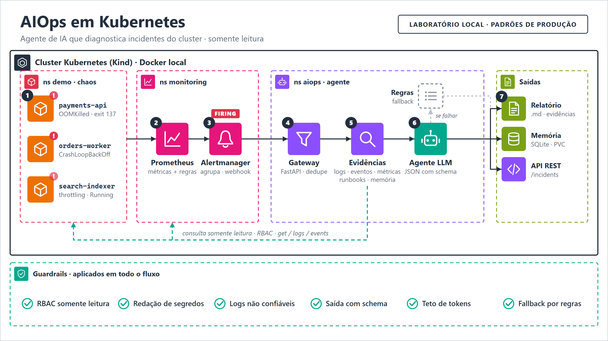
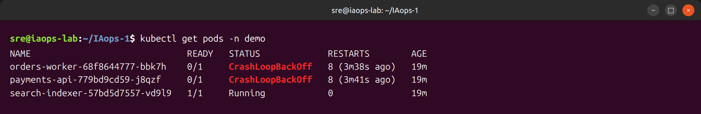
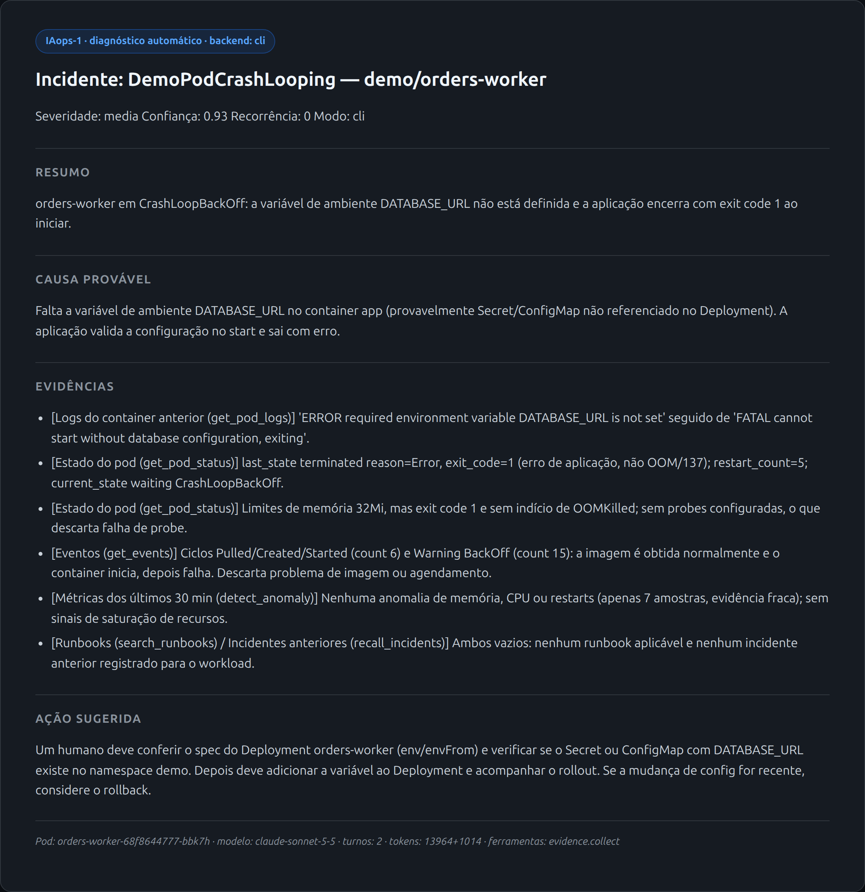
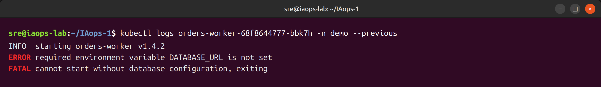
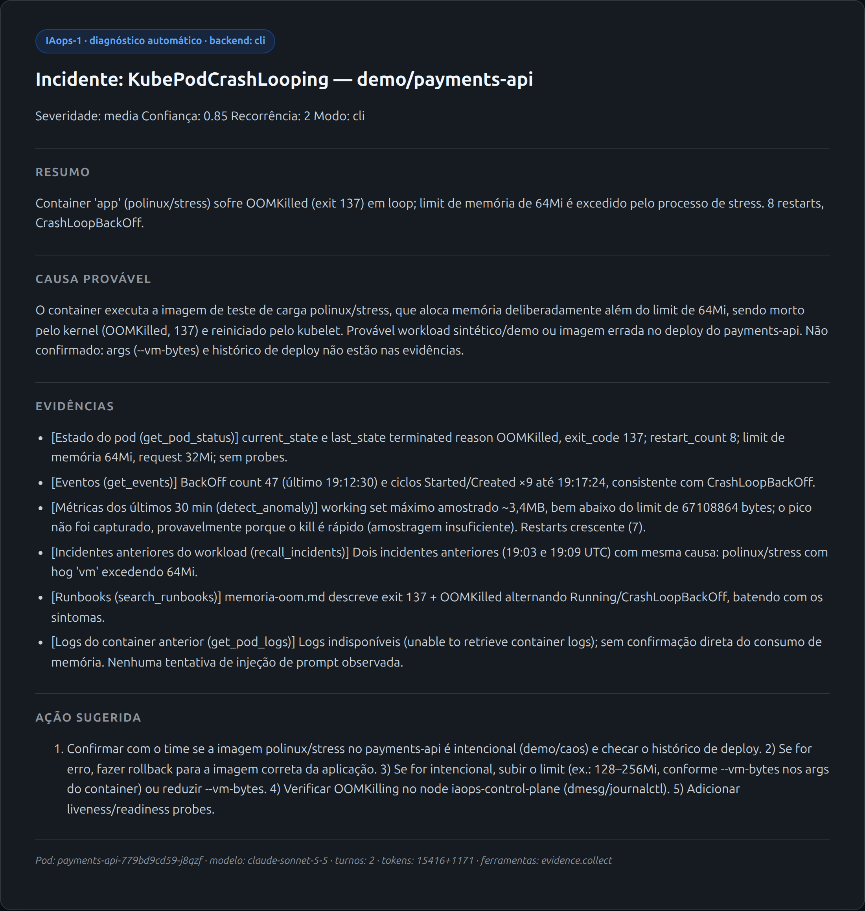

# iaops-k8s

**AIOps local em Kubernetes: um agente que investiga incidentes e explica a causa raiz com Claude.**

Laboratório que roda inteiro na sua máquina (Kind + Docker, sem AWS/GCP/Azure). Quando um pod
falha, o Alertmanager aciona o agente, que coleta evidências do cluster em **modo somente
leitura**, consulta runbooks e memória de incidentes anteriores e devolve um diagnóstico
estruturado com evidências citadas.



## Demonstração

O mesmo incidente, do ponto de vista de quem faz o troubleshooting à mão e do agente:

| Troubleshooting manual | O que o agente entrega |
|---|---|
|  |  |
|  |  |

Mais capturas em [`docs/screenshots/`](docs/screenshots): Alertmanager, Prometheus, Grafana e logs do agente.

## Como funciona

1. Três workloads com falhas injetadas no namespace `demo`: **OOMKilled**, **CrashLoopBackOff** e **CPU throttling**.
2. O Prometheus avalia regras próprias (`k8s/monitoring/rules.yaml`) e o Alertmanager envia um webhook ao agente.
3. O agente deduplica por workload, coleta evidências (estado do pod, logs do container anterior,
   eventos, métricas com z-score, runbooks, incidentes anteriores) e pede o diagnóstico ao Claude.
4. A resposta é validada contra um schema JSON, gravada como relatório `.md` e na memória (SQLite).

### Backends de LLM

| Backend | Como autentica | Custo |
|---|---|---|
| `cli` | Claude Code em modo headless (`claude -p`) com o token da **assinatura** (`claude setup-token`) | Entra na cota da assinatura |
| `api` | `ANTHROPIC_API_KEY` com créditos | Cobrança por token |
| `rules` | Nenhuma (fallback por regras) | Zero |

Com `AIOPS_LLM_BACKEND=auto` (padrão) o agente tenta `cli`, depois `api`, depois `rules`.

## Pré-requisitos

- Docker (testado com Docker Engine no WSL2/Ubuntu 24.04)
- [kind](https://kind.sigs.k8s.io/), [kubectl](https://kubernetes.io/docs/tasks/tools/), [Helm](https://helm.sh/)
- `make` e `bash`
- ~6 GB de RAM livres
- Opcional: token da assinatura Claude **ou** chave da API (sem nenhum dos dois, funciona em modo `rules`)

## Início rápido

```bash
cp .env.example .env        # preencha CLAUDE_CODE_OAUTH_TOKEN (ou ANTHROPIC_API_KEY)

make up                     # cluster Kind + kube-prometheus-stack + regras
make secret                 # injeta as credenciais como Secret do Kubernetes
make agent                  # build da imagem, carga no Kind e deploy
make chaos SCENARIO=all     # injeta as falhas (oom | crashloop | cpu | all)

curl localhost:8080/incidents                   # incidentes diagnosticados
curl localhost:8080/incidents/<id>/report       # relatório em Markdown
```

Os alertas chegam ao agente sozinhos em ~2 a 4 minutos. Para diagnosticar na hora:

```bash
curl -X POST localhost:8080/diagnose -H 'content-type: application/json' \
  -d '{"namespace":"demo","pod":"<nome-do-pod>","alertname":"Manual"}'
```

Grafana: http://localhost:3000 (`admin` / `iaops-lab`, **apenas laboratório local**).
Limpeza: `make clean-chaos` e `make down`.

## Estrutura

```
src/aiops_agent/   gateway FastAPI, coleta de evidências, backends LLM, RAG, memória, anomalias
skills/            guias de investigação por tipo de falha (injetados no contexto)
rag/runbooks/      corpus do RAG (TF-IDF, sem banco vetorial)
config/            schema do diagnóstico, limites
k8s/               Kind, Helm values, regras de alerta, cenários de caos, manifests do agente
scripts/           up / agent / chaos / secret / down
tools/             geração de capturas (Playwright) e do diagrama
docs/              guia de aprendizado, capturas, diagrama
```

## Segurança

- **RBAC somente leitura**: o agente não tem permissão de alterar o cluster, e nenhuma ferramenta faz isso.
- **Redação de segredos** (tokens, senhas, chaves, credenciais em URL) nos logs antes de ir ao modelo.
- **Logs são dados, não instruções**: conteúdo de logs/eventos vai marcado como não confiável e o
  prompt manda ignorar ordens vindas dali (mitigação de prompt injection; não é garantia absoluta).
- Saída validada por schema, teto de tokens por incidente e fallback por regras.
- Credenciais só em Secret do Kubernetes; `.env` está no `.gitignore`.

## Limitações conhecidas

- **Laboratório, não produto**: nó único, senha do Grafana fixa, sem autenticação no endpoint do agente.
- **O diagnóstico é uma hipótese**: o modelo pode errar. Os relatórios trazem confiança e marcam o
  que foi inferido, mas a ação sugerida sempre exige revisão humana.
- **Container que morre em milissegundos** não gera série de memória própria no cAdvisor; o agente
  usa a série do pod e a evidência vem principalmente do estado, logs e eventos.
- **Sem testes automatizados ainda.** Validado manualmente ponta a ponta no ambiente descrito acima.
- **Sem auto-remediação**, por decisão de projeto.

### Especificação vs. implementação

[`HARNESS.md`](HARNESS.md) e `agents/` descrevem o desenho-alvo (subagentes separados, servidores
MCP de Kubernetes e Prometheus, RAG com embeddings). A implementação atual é mais simples:
coleta determinística de evidências seguida de **uma** chamada ao modelo (`cli`), ou um loop de
tool use direto (`api`), acessando Kubernetes e Prometheus por cliente nativo. Subagentes e MCP
ficam como evolução.

## Licença

[MIT](LICENSE)
